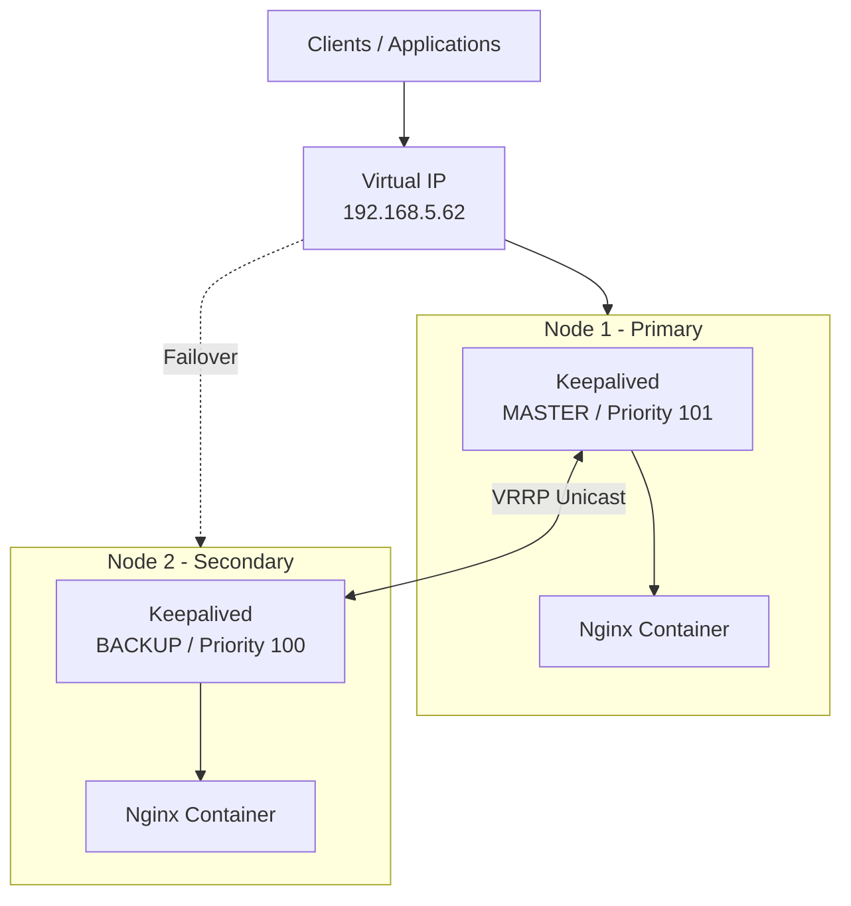

# High-Availability Nginx Reverse Proxy with Keepalived

[](https://www.docker.com/)
[](https://nginx.org/)
[](https://www.keepalived.org/)

A highly available Nginx reverse proxy infrastructure running across two independent Linux servers using Docker Compose and Keepalived.

The solution uses the Virtual Router Redundancy Protocol (VRRP) to maintain a shared Virtual IP (VIP). If the primary node becomes unavailable, the secondary node takes ownership of the VIP, allowing incoming traffic to continue through the backup server.

The goal is to eliminate a single point of failure at the reverse proxy layer.

---

## Table of Contents

- [Architecture Overview](#architecture-overview)
- [Network Configuration](#network-configuration)
- [Repository Structure](#repository-structure)
- [How It Works](#how-it-works)
- [Prerequisites](#prerequisites)
- [Configuration](#configuration)
- [Deployment](#deployment)
- [Verification](#verification)
- [Failover Testing](#failover-testing)
- [Troubleshooting](#troubleshooting)
- [Security Considerations](#security-considerations)

---

## Architecture Overview

The infrastructure consists of two independent Docker hosts running identical Nginx reverse proxy services.

Keepalived manages the shared Virtual IP and determines which node is currently responsible for handling incoming traffic.

### Network Architecture



### Node Responsibilities

| Component | Node 1 | Node 2 |
|---|---|---|
| Role | Primary | Secondary |
| Host IP | 192.168.5.45 | 192.168.5.40 |
| Virtual IP | 192.168.5.62 | 192.168.5.62 |
| Keepalived State | MASTER | BACKUP |
| VRRP Priority | 101 | 100 |
| Nginx | Active | Active |

Both Nginx containers remain running. Keepalived controls which host owns the VIP.

---

## Network Configuration

The following values reflect the current example configuration.

| Setting | Value |
|---|---|
| Node 1 IP | `192.168.5.45` |
| Node 2 IP | `192.168.5.40` |
| Virtual IP | `192.168.5.62/24` |
| Network Interface | `eno1` |
| VRRP Instance | `VI_1` |
| VRRP Router ID | `51` |
| VRRP Advertisement Interval | 1 second |
| Node 1 Priority | 101 |
| Node 2 Priority | 100 |

**Important:** Both nodes must use the same `virtual_router_id`, authentication configuration, and VIP.

The network interface name must also match the actual interface on each Linux host. Change `eno1` if your environment uses something different, such as `ens18`.

---

## Repository Structure

```text
R-Proxy-Keepalived/
│
├── Node1/
│   ├── docker-compose.yml
│   ├── keepalived.conf
│   ├── nginx.conf
│   └── certs/
│
├── Node2/
│   ├── docker-compose.yml
│   ├── keepalived.conf
│   ├── nginx.conf
│   └── certs/
│
└── README.md
```

The `certs` directories are mounted into the Nginx containers for certificate storage. HTTPS configuration still needs to be added to Nginx before those certificates are used.

---

## How It Works

### 1. Nginx Reverse Proxy

Each node runs an independent Nginx container.

Nginx listens on port 80 and handles incoming HTTP requests.

The current example returns a simple response identifying the hostname handling the request.

### 2. Keepalived and VRRP

Keepalived monitors the availability of its peer using VRRP unicast advertisements.

Node 1 starts with MASTER status and has a higher priority.

Node 2 starts as BACKUP and monitors Node 1.

If Node 1 becomes unavailable, Node 2 takes ownership of the Virtual IP.

### 3. Virtual IP Failover

The VIP is the single entry point for clients.

Applications and DNS records should reference the VIP rather than either individual node address.

This allows the infrastructure to move traffic between nodes without requiring changes to client configurations.

---

## Prerequisites

Both Linux hosts require:

- Linux operating system with Docker support.
- Docker Engine.
- Docker Compose plugin.
- Network connectivity between both nodes.
- Static IP addresses.
- Root or equivalent administrative privileges.
- Firewall rules permitting required traffic.

### Required Network Access

| Protocol | Port | Purpose |
|---|---:|---|
| TCP | 80 | HTTP |
| TCP | 443 | HTTPS (when configured) |
| IP Protocol 112 | N/A | VRRP communication |

For unicast VRRP, permit protocol 112 between the two node addresses.

---

## Configuration

### Docker Compose

Both nodes use the same basic Docker Compose configuration.

The stack consists of two services:

- `nginx-proxy`: Nginx reverse proxy.
- `keepalived`: VRRP management and VIP failover.

The Keepalived container uses host networking because it needs access to the host network interface.

It also requires network administration capabilities to manage the VIP.

### Keepalived Configuration

Node 1 is configured as the primary node.

Node 2 is configured as the secondary node.

The following settings must be adjusted for your environment:

```conf
interface eno1
virtual_router_id 51
unicast_src_ip <LOCAL_NODE_IP>

unicast_peer {
    <PEER_NODE_IP>
}

virtual_ipaddress {
    192.168.5.62/24 dev eno1
}
```

Node 1 should use:

- State: MASTER
- Priority: 101
- Local IP: 192.168.5.45
- Peer IP: 192.168.5.40

Node 2 should use:

- State: BACKUP
- Priority: 100
- Local IP: 192.168.5.40
- Peer IP: 192.168.5.45

**Health checking:** The existing `killall` health-check script should be replaced with a check that verifies Nginx through its published HTTP endpoint. The Keepalived and Nginx containers have separate process namespaces, so the current process check cannot reliably monitor Nginx.

---

## Deployment

### Step 1 - Clone the Repository

On both Linux hosts:

```bash
git clone https://github.com/TroyCollin/R-Proxy-Keepalived.git

cd R-Proxy-Keepalived
```

### Step 2 - Configure Node 1

On the primary server:

```bash
cd Node1
```

Verify the following settings:

- Host interface.
- Local IP address.
- Peer IP address.
- Virtual IP.
- VRRP Router ID.
- Authentication configuration.

### Step 3 - Configure Node 2

On the secondary server:

```bash
cd ../Node2
```

Verify that the configuration reflects the secondary node's network information.

Both nodes must use the same VRRP Router ID.

### Step 4 - Start the Docker Services

On Node 1:

```bash
cd Node1
docker compose up -d
```

On Node 2:

```bash
cd Node2
docker compose up -d
```

### Step 5 - Verify Containers

Run on both servers:

```bash
docker compose ps
```

Review the logs:

```bash
docker logs nginx-proxy

docker logs keepalived
```

---

## Verification

### Verify VIP Ownership

Run the following command on both servers:

```bash
ip addr show eno1
```

Under normal operation, the VIP should appear on Node 1 only.

Node 2 should not have the VIP while Node 1 is operating as MASTER.

### Test Nginx

From another machine:

```bash
curl http://192.168.5.62
```

Expected response:

```text
HA Cluster Active! Responding from hostname: <hostname>
```

The hostname identifies which Nginx container handled the request.

### Monitor Keepalived

Check the logs:

```bash
docker logs -f keepalived
```

Look for MASTER and BACKUP state transitions.

---

## Failover Testing

Failover testing is important to ensure that the infrastructure behaves as expected when a node becomes unavailable.

### Test 1 - Primary Node Failure

From another machine, continuously ping the VIP:

```bash
ping 192.168.5.62
```

On Node 1, stop the Docker stack:

```bash
cd Node1
docker compose down
```

Expected behavior:

1. Node 1 stops advertising its VRRP MASTER state.
2. Node 2 detects the loss of the primary node.
3. Node 2 transitions to MASTER.
4. Node 2 acquires the Virtual IP.
5. Incoming traffic resumes through Node 2.

Verify VIP ownership on Node 2:

```bash
ip addr show eno1
```

Test the reverse proxy:

```bash
curl http://192.168.5.62
```

### Test 2 - Primary Node Recovery

Restart the services on Node 1:

```bash
cd Node1
docker compose up -d
```

With the default preemption behavior and the higher priority, Node 1 should reclaim MASTER status once it is healthy.

Verify the VIP has returned to Node 1.

### Test 3 - Nginx Service Failure

Stop only the Nginx container on Node 1:

```bash
docker stop nginx-proxy
```

Verify that the configured Keepalived health check detects the failure and triggers the expected transition.

This test should only be considered successful after the health-check implementation has been corrected.

---

## Troubleshooting

| Problem | Possible Cause | Suggested Check |
|---|---|---|
| VIP does not appear | VRRP configuration mismatch | Compare both keepalived.conf files |
| Both nodes claim VIP | VRRP communication failure | Check protocol 112 and router IDs |
| VIP stays on failed node | Health check not working | Review Keepalived logs |
| Nginx unavailable | Container not running | Check `docker compose ps` |
| HTTP connection refused | Port publishing or firewall issue | Check ports 80 and 443 |
| HTTPS unavailable | TLS listener not configured | Review nginx.conf |
| Failover does not occur | Peer communication issue | Check unicast peer IPs |

Useful diagnostic commands:

```bash
# Show interface configuration
ip addr show

# Check Docker containers
docker ps -a

# Check Keepalived logs
docker logs keepalived

# Check Nginx logs
docker logs nginx-proxy

# Test VIP connectivity
ping 192.168.5.62

# Test HTTP response
curl -v http://192.168.5.62
```

---

## Security Considerations

Before using this solution in production:

- Replace the example VRRP authentication password.
- Do not commit production passwords or secrets to Git.
- Restrict VRRP traffic to the two participating nodes.
- Restrict management access to trusted administrators.
- Configure TLS certificates and HTTPS listeners before exposing port 443.
- Keep Docker images and the underlying operating system patched.
- Review container capabilities and privileges.
- Implement a reliable Nginx health-check mechanism.

VRRP password authentication should not be treated as a strong security boundary.

---

## Project Goals

This project demonstrates a practical approach to improving reverse proxy availability using:

- Docker containerization.
- Nginx reverse proxy services.
- Keepalived VRRP failover.
- Shared Virtual IP addressing.
- Automated primary/secondary node transitions.
- Infrastructure resilience and service continuity.

The architecture can be extended to support multiple backend applications, SSL termination, monitoring, and additional reverse proxy configurations.

---

**Repository:** [R-Proxy-Keepalived](https://github.com/TroyCollin/R-Proxy-Keepalived)


